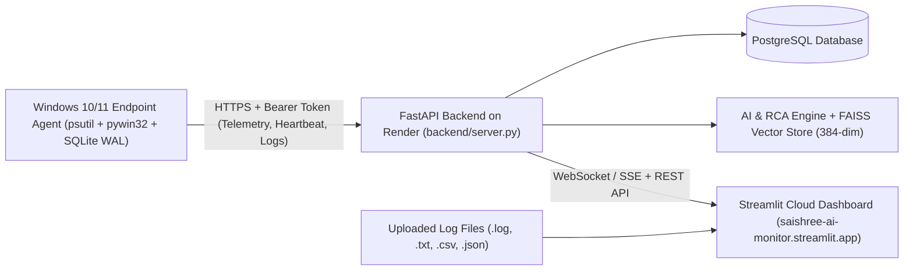

# Enterprise Autonomous AI Infrastructure Monitoring System
**Complete Teacher Presentation, Architecture & Viva Reference Sheet**

> **Live Dashboard UI:** https://saishree-ai-monitor.streamlit.app/  
> **Live Cloud Backend API:** https://ai-monitor-backend-vhix.onrender.com/  
> **GitHub Repository & CI Runs:** https://github.com/nitish-n225/ai-infra-monitor/actions

---

## 1. One-Minute Project Explanation (Start Here)

**What problem does it solve?**  
Modern servers, databases, and Windows workstations generate thousands of logs every minute. Traditional monitoring fails in two ways:
1. **Keyword search (`grep` / `SQL LIKE`) misses meaning** — searching `"database down"` will not find `"FATAL: remaining connection slots reserved"`.
2. **Manual triage is slow during cascading failures** — one memory leak in Redis can overload PostgreSQL, trigger `504 Gateway Timeout`, and crash microservices within minutes.

**What did we build?**  
An **end-to-end, real-time AIOps monitoring platform** with three connected tiers:
1. **Windows Monitoring Agent (`agent/`):** Runs on Windows 10/11 PCs (with explicit user consent), collecting live CPU/RAM/disk/network metrics, Windows Event Viewer logs, and application log files, with an offline SQLite retry queue.
2. **Central FastAPI Backend (`backend/`):** Deployed on Render with PostgreSQL persistence, JWT & device token authentication, real-time WebSocket/SSE streaming, automated RCA, and persistent 384-dimensional FAISS vector indexing.
3. **Streamlit Command Center (`app.py`):** Deployed on Streamlit Community Cloud with two workspaces — **Live Fleet** (real-time multi-device monitoring) and **Log Analyzer** (upload `.log`, `.txt`, `.csv`, `.json` or test built-in outage traces).

---

## 2. System Architecture

---

## 3. Every Module Explained Clearly (With Exact Logic)

### Module 1: Multi-Format Log Parser (`src/parser.py`)
Normalizes messy logs into a clean table (`line_no`, `timestamp`, `level`, `service`, `message`, `raw_line`):
- **Bracketed logs:** `2026-10-25 10:00:01 [INFO] [ingress-gateway] ...`
- **Standard ISO logs:** `2026-10-25T10:00:01Z ERROR auth-service: ...`
- **Syslog:** `Oct 25 10:15:30 cluster-node-01 systemd[1]: ...`
- **JSON / NDJSON & JSON Arrays:** Docker/Kubernetes structured JSON logs
- **CSV logs:** Re-analyzes exported telemetry/log CSV files
- **Unstructured fallback:** Automatically infers severity (`CRITICAL`, `ERROR`, `WARN`, `DEBUG`, `INFO`) from keywords if a line doesn't match standard formats.

---

### Module 2: Infrastructure Health Score (`src/health_score.py`)
Computes an explainable **0–100% Health Index** starting from `100.0`:

$$\text{Health Score} = \max\bigl(0,\; 100.0 - \text{Total Deductions}\bigr)$$

| Deduction Rule | Penalty | Cap |
|---|---|---|
| `CRITICAL` / `FATAL` events | `-18.0 pts` per event | Max `-50 pts` |
| `ERROR` events | `-8.0 pts` per event | Max `-40 pts` |
| `WARN` / `WARNING` events | `-2.0 pts` per event | Max `-20 pts` |
| Multi-service spread (`>= 3` failing services) | `-12.0 pts` flat | — |
| High failure density (`> 20%` error rate) | `-10.0 pts` flat | — |

**Classification Thresholds:**
- **Stable:** `80% – 100%` (Green)
- **Warning:** `50% – 79.9%` (Amber)
- **Critical:** `< 50%` (Red)

---

### Module 3: Predictive Failure Risk Index (`src/predictive_failure.py`)
Estimates operational instability risk on a **0–100 scale** using 4 weighted factors (requires at least 3 log records):

| Factor | Max Weight | How It Is Measured |
|---|---|---|
| **1. Failure Log Density** | `35 pts` | `(CRITICAL + FATAL + ERROR) / total_logs × 70` (capped at 35) |
| **2. Critical Severity Weight** | `25 pts` | `(critical_count × 8.0) + (error_count × 2.0)` (capped at 25) |
| **3. Cascading Service Propagation** | `25 pts` | `0` (0 failing services), `8` (1), `16` (2), `25` (`>= 3` services) |
| **4. Temporal Acceleration** | `15 pts` | Compares errors in the second half vs first half of the log timeline |

**Risk Levels:** `LOW` (`< 10`), `MODERATE` (`10–29.9`), `ELEVATED` (`30–54.9`), `HIGH` (`55–79.9`), `CRITICAL` (`>= 80`).

> *Note:* In live telemetry mode, `backend/ai_pipeline.py` also computes **Hardware Trend Forecasts** (CPU/RAM/Disk slope per sample across recent telemetry snapshots) to warn before resource exhaustion occurs.

---

### Module 4: Root Cause Analysis Engine (`src/rca_engine.py` + `backend/ai_pipeline.py`)
Automatically classifies failures across **6 core infrastructure categories** (plus Windows Event Viewer fault patterns in live mode) and attaches **exact source-line evidence**:
1. **Database Failure** (`DATABASE_FAILURE`) — e.g., connection pool exhausted, `remaining connection slots reserved`, `PG::ConnectionBad`, deadlocks
2. **CPU Overload** (`CPU_OVERLOAD`) — e.g., CPU throttling, thread pool exhausted, worker starvation
3. **Memory Leak / OOM** (`MEMORY_LEAK_OOM`) — e.g., `OOMKilled`, `Exit code 137`, Redis `maxmemory`, Windows Resource Exhaustion (`EventID 2004`)
4. **Storage Failure** (`STORAGE_FAILURE`) — e.g., `no space left on device`, read-only filesystem, NTFS/disk controller errors (`EventID 7, 11, 51, 55, 153`)
5. **Authentication Failure** (`AUTHENTICATION_FAILURE`) — e.g., JWT signature/expiry errors, `401 Unauthorized`, Windows logon failure (`EventID 4625`)
6. **Network Latency / Instability** (`NETWORK_LATENCY`) — e.g., `504 Gateway Timeout`, `circuit breaker OPEN`, DNS resolution failed

---

### Module 5: Safe Self-Healing Engine (`src/self_healing.py`)
Maps each detected RCA category to structured **advisory recovery playbooks** (such as `ACT_DB_01` connection pool draining, `ACT_MEM_01` volatile cache flush, `ACT_NET_01` half-open circuit breaker probe) with:
- Reason, prerequisites, and post-action verification steps.
- **Strict Safety Gate:** Live OS/infrastructure execution is **blocked by policy** (`execute_recovery_action()` raises `RuntimeError`). Operators can only run **Dry-Run Simulations** (`simulate_action()`).

---

### Module 6: Semantic Search with FAISS (`src/embedding_engine.py`, `src/vector_store.py`, `backend/ai_pipeline.py`)
- Converts each log record (`[service] [level] message`) into an **L2-normalized 384-dimensional vector** and indexes it in **`faiss.IndexFlatIP(384)`** (Inner Product on unit vectors = exact Cosine Similarity).
- **Two Embedding Modes (Cloud-Ready):**
  1. **Transformer Mode:** `SentenceTransformer('all-MiniLM-L6-v2')` when full RAM is available.
  2. **Low-Memory Mode (`LOW_MEMORY_MODE=true`):** 384-dim word + character-trigram Blake2b hash embeddings (~2 MB RAM) so Render Free Tier (512 MB RAM) and Streamlit Cloud run smoothly without OOM crashes, plus a NumPy fallback if FAISS isn't loaded.
- **Persistence on Ephemeral Cloud Disks:** On backend startup, `rebuild_from_db_if_empty()` automatically rebuilds the FAISS index from events saved in PostgreSQL.

---

### Module 7: Grounded Conversational AI Assistant (`src/assistant_engine.py`)
- **Dual-Engine Design:**
  - **Deterministic Evidence Engine (Default / Offline):** Zero API cost, zero internet dependency. Parses user intent (incidents, root cause, affected services, health breakdown, risk factors, recovery steps, semantic search) and builds structured answers directly from active logs and RCA results.
  - **Optional Cloud LLM (`OPENAI_API_KEY`):** Sends grounded telemetry + log evidence at `temperature=0.1` and automatically falls back to the deterministic engine if the API fails.
- **Anti-Hallucination Guarantee:** Distinguishes **Observed Facts** from **Inferred Root Causes**, cites exact **Line numbers / Timestamps / Services**, and returns **`Insufficient Evidence in Active Logs`** when asked about things not in the logs.

---

### Module 8: Windows Monitoring Agent & Security (`agent/`, `backend/auth.py`, `backend/database.py`)
- **Explicit Consent & Enrollment:** Remote PCs cannot connect without a time-limited, usage-capped **Enrollment Token** and explicit user consent (`--accept-consent` or typing `YES` in `install_agent.ps1`).
- **Real Endpoint Telemetry:** Collects CPU, RAM, multi-drive disk volumes, network KB/s, top processes, Windows Services status, `System` & `Application` (optional `Security`) Event Viewer logs, and custom watched application log files.
- **Offline Resilience:** Buffers unsent events in local **SQLite WAL** (`agent_state.db`) and deduplicates by deterministic `event_uid` when reconnected.
- **Heartbeat Watchdog:** Backend checks heartbeats every 5s and automatically marks silent hosts `OFFLINE` after `DEVICE_OFFLINE_SECONDS` (default `30s`), optionally sending Slack/Teams webhook alerts and recording an audit trail.

---

## 4. Exact 5-Minute Live Demo Script

### Before Presenting (30 Seconds)
Open these 3 tabs in your browser:
1. **Dashboard:** https://saishree-ai-monitor.streamlit.app/ (if Render was asleep, click **🔄 Wake Backend Now** until the top badge shows **`Backend Online • POSTGRESQL`**).
2. **Backend API:** https://ai-monitor-backend-vhix.onrender.com/ (shows `{"status": "online", ...}`).
3. **CI Pipeline:** https://github.com/nitish-n225/ai-infra-monitor/actions (shows green automated checks).

### Minute 1 — Architecture & Live Fleet (`Live Fleet` Mode)
1. Show the backend tab (`status: "online"`) and `/health` (`database: "postgresql"`).
2. On the Streamlit dashboard in **Live Fleet**, sign in (`admin`) and show **📡 Fleet Overview**:
   - Point to your live Windows laptop (`LAPTOP-87VKPB27`) showing **`ONLINE`**, CPU/RAM/Disk bars, Network KB/s, Disk Volumes, Top Processes, and live Windows Event Viewer logs.
3. Briefly click **⚙️ Fleet Admin** to show token-based enrollment, remote agent config push, device revocation, webhook alerts, and security audit logs.

### Minute 2–3 — Healthy vs Cascading Outage (`Log Analyzer` Mode)
1. Switch sidebar **Workspace** to **`Log Analyzer`**.
2. Go to **📥 Upload Logs** → click **🟢 Healthy Operations Trace** → switch to **📊 Overview**:
   - Show **Health Index `100%`**, **Failure Risk `0/100`**, and all services healthy.
3. Go back to **📥 Upload Logs** → click **🔥 Production Incident Trace** (explain the 21-line cascade: Redis OOM → DB connection pool 50/50 exhausted → `504 Gateway Timeout` → `OOMKilled` Exit 137):
   - Show **📊 Overview**: Health Score drops sharply and Failure Risk surges.
   - Show **🔍 Incidents & RCA**: Expand the root cause cards, show exact line-numbered evidence, and click **🧪 Simulate Dry-Run** on a playbook.

### Minute 4 — Semantic Search & Grounded AI Assistant
1. Go to **🔎 Semantic Search** → click **⚡ Index Active Logs**.
   - Search **`"database down"`** → point out it finds `FATAL: remaining connection slots reserved` even though the words *"database"* and *"down"* are not in that message.
2. Go to **🤖 AI Assistant**:
   - Click **🚨 Critical incidents?** → expand **📑 Evidence** to show line-number citations.
   - Type **`"What is the GPU temperature?"`** → show it safely answers **`Insufficient Evidence in Active Logs`** instead of hallucinating.

### Minute 5 — Testing & CI/CD Proof
1. Switch to **GitHub Actions** (https://github.com/nitish-n225/ai-infra-monitor/actions) to show automated **Ubuntu (`backend-and-ui`)** and **Windows (`windows-agent-e2e`)** verification running on every push.

---

## 5. Top 8 Teacher Viva Questions & Answers

| Question | Clear, Ready Answer |
|---|---|
| **1. Why use FAISS semantic search instead of SQL `LIKE` or `grep`?** | Keyword search fails when services phrase failures differently (`"database down"` vs `"remaining connection slots reserved"`). Mapping logs into 384-dim unit vectors and computing cosine similarity via `IndexFlatIP` retrieves contextually matching incidents in milliseconds. |
| **2. Does the AI Assistant hallucinate or invent answers?** | No. Every answer is grounded in parsed log records, RCA findings, and health/risk metrics. It separates **Observed Facts** from **Inferred Causes**, cites exact line numbers, and outputs `Insufficient Evidence in Active Logs` if data is missing. |
| **3. Why not let the Self-Healing module execute fixes automatically?** | Unchecked automated commands (`kill`, `flush`, `restart`) in production can cause worse outages. By design, `execute_recovery_action()` raises a `RuntimeError` safety gate, allowing only operator-reviewed advisory playbooks and dry-run simulations. |
| **4. How do you distinguish this from a static log viewer?** | It has a real **Windows Agent** (`psutil` + `pywin32`) streaming live OS telemetry and Event Viewer logs over HTTPS/WebSocket to a cloud **FastAPI + PostgreSQL** backend with multi-tenant org filtering and offline watchdog detection. |
| **5. What happens if the laptop loses internet connection?** | The agent buffers events in a local **SQLite WAL queue** (`agent_state.db`) and uses deterministic `event_uid` hashes so re-sending after reconnection never creates duplicate rows in PostgreSQL. |
| **6. How did you handle cloud memory limits (512 MB Render Free Tier)?** | Enabled `LOW_MEMORY_MODE` with 384-dim Blake2b word+trigram hash embeddings (~2 MB RAM vs ~500 MB for PyTorch), async background FAISS indexing during ingestion, and automatic FAISS rebuild from PostgreSQL on ephemeral restarts. |
| **7. How is security enforced between endpoints and dashboard?** | Operators authenticate with **PBKDF2-hashed passwords + HMAC-SHA256 JWTs**; endpoints authenticate with per-device **Bearer tokens** issued only after **Enrollment Token** validation and explicit consent; admins can immediately **revoke** a compromised device. |
| **8. How did you verify correctness?** | Through automated test suites covering log parsing (`test_stage1.py`), RCA/health/risk/safety (`test_stage2.py`), FAISS indexing (`test_stage3.py`), assistant grounding (`test_stage4.py`), UI & hardening (`test_ui_and_hardening.py`), Render persistence (`test_render_readiness.py`), backend API integration (`test_backend_and_ai.py`), and Windows E2E (`test_e2e_live.py`), automated via GitHub Actions CI. |
